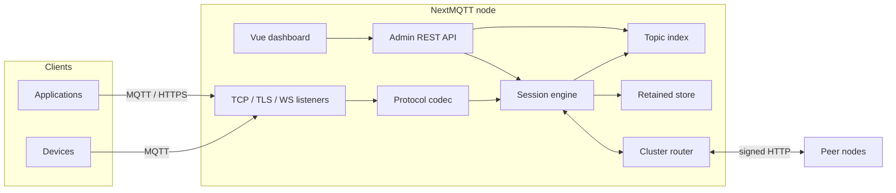

# NextMQTT

**The next-generation MQTT platform, built natively on .NET 10 and Vue 3.**

[简体中文](README.md) | English | [日本語](README.ja.md) | [한국어](README.ko.md)

NextMQTT is an independent implementation of the OASIS MQTT 3.1.1 and MQTT 5.0
specifications. It ships an async broker, a management REST API, a
real-time operations dashboard, and first-class Docker / Kubernetes
deployment assets.

[](https://github.com/cn-cam/next-mqtt/actions/workflows/ci.yml)
[](LICENSE)
[](https://dotnet.microsoft.com/)
[](https://mqtt.org/)

---

## Why NextMQTT

- **A new .NET 10 foundation.** The broker, management API and dashboard run in
  one modern ASP.NET Core process. No external database or message middleware
  is required.
- **Designed for operations.** Live client/subscription views, retained
  message inspection, cluster topology, publish console, API console and
  Prometheus metrics are built in.
- **Predictable concurrency.** `System.IO.Pipelines` for framing, bounded
  channels for back-pressure, per-session inflight windows, and async
  everything.
- **Cluster-ready from the start.** Stateless-edge routing with gossip
  membership and signed internal transport; add nodes without a coordinator.
- **Boring deployments.** Multi-arch container image, Helm chart, raw
  Kubernetes manifests, health probes and graceful shutdown.

## Feature highlights

| Area | Capabilities |
| --- | --- |
| Protocol | MQTT 3.1.1 and MQTT 5.0 over TCP, TLS, WebSocket and secure WebSocket |
| QoS | QoS 0, 1 and 2 in both directions, retransmission and inflight windows |
| Sessions | Clean start, persistent sessions, expiry, takeover, offline queue, cross-node handover and replicas |
| Messaging | Retained messages, message expiry, will messages, will delay |
| Subscriptions | Wildcards, shared subscriptions, no-local, retain-as-published, retain handling |
| Security | Password auth, JWT auth, anonymous toggle, topic ACLs, TLS, admin token auth |
| Cluster | Gossip membership, signed node-to-node transport, cross-node routing, global shared subscriptions |
| Observability | Prometheus metrics, JSON statistics, structured logs, health probes |
| Management | REST API, Vue 3 dashboard, API console, audit-friendly admin tokens |

## Architecture at a glance



The broker separates the **data plane** (connections, sessions, routing,
delivery) from the **control plane** (REST API, dashboard, cluster membership).
Read [docs/architecture.md](docs/architecture.md) for the full design, data
structures and failure model.

## Quick start

### Docker

```bash
docker run -d --name nextmqtt \
  -p 1883:1883 \
  -p 8080:8080 \
  -e NEXTMQTT_ADMIN_PASSWORD='change-me-now' \
  ghcr.io/cn-cam/next-mqtt:latest
```

Docker Hub mirror:

```bash
docker run -d --name nextmqtt \
  -p 1883:1883 -p 8080:8080 -p 8083:8083 \
  -e NEXTMQTT_ADMIN_PASSWORD='change-me-now' \
  oooooooooocam/next-mqtt:latest
```

Open <http://localhost:8080> and sign in as `admin` with the password you
passed. MQTT clients connect to `mqtt://localhost:1883`.

### Single node and three-node deployments

Both shapes use the same image:

```bash
# single node
cp .env.example .env
# edit the admin password and token secret
docker compose up -d

# three-node cluster
export NEXTMQTT_CLUSTER_SECRET='a-long-shared-secret'
docker compose -f deploy/compose/docker-compose.cluster.yml up -d
```

Host ports for the three-node cluster:

| Node | MQTT | Dashboard | HTTPS |
| --- | --- | --- | --- |
| node-a | 1883 | 8080 | 8086 |
| node-b | 1884 | 8081 | 8087 |
| node-c | 1885 | 8082 | 8088 |

Use the certificate name with the host port, for example
`https://next-mqtt.deploy-ssl.co:8086/`. Do not use the container port 8084 from
the Compose deployment. GitHub Pages only hosts the documentation; it does not
run a broker. Use Docker, Compose, Kubernetes or Helm to deploy the broker.

### From source

```bash
# Broker + API (defaults are safe for local development)
dotnet run --project src/NextMqtt.Server

# Dashboard dev server (proxies /api to :8080)
cd web
npm install
npm run dev
```

Requirements: .NET SDK 10.0.100+, Node.js 22+ (24 recommended).

### Command line client

```bash
# subscribe in one terminal
dotnet run --project src/NextMqtt.Cli -- sub --topic demo/# --qos 1

# publish from another
dotnet run --project src/NextMqtt.Cli -- pub --topic demo/hello --message hi --qos 1 --retain

# throughput check
dotnet run --project src/NextMqtt.Cli -- bench --clients 20 --messages 1000 --size 128
```

The CLI speaks MQTT 5 and 3.1.1, supports TLS, and can hash dashboard/ACL
passwords with `hash-password`.

## Ports

| Port | Protocol | Purpose |
| --- | --- | --- |
| 1883 | MQTT over TCP | Device and application traffic |
| 8883 | MQTT over TLS | Encrypted MQTT traffic |
| 8083 | MQTT over WebSocket (`/mqtt`) | Browser and edge clients |
| 8084 | MQTT over secure WebSocket (`/mqtt`) | Encrypted browser traffic |
| 8080 | HTTP | REST API, dashboard, `/metrics`, `/healthz` |

All ports are configurable via `NEXTMQTT_*` environment variables or
`appsettings.json`. See [docs/configuration.md](docs/configuration.md).

## Deployment

- Container image: `ghcr.io/cn-cam/next-mqtt` and `oooooooooocam/next-mqtt`
  (linux/amd64, linux/arm64)
- Kubernetes: `deploy/kubernetes` (Kustomize) and `deploy/helm/next-mqtt`
- Compose: `docker-compose.yml` and
  `deploy/compose/docker-compose.cluster.yml`

```bash
kubectl apply -k deploy/kubernetes
# or
helm install nextmqtt deploy/helm/next-mqtt \
  --namespace nextmqtt --create-namespace \
  --set admin.password='change-me-now' \
  --set cluster.secret='change-me-shared-secret'
```

## Project layout

```text
src/NextMqtt.Core        MQTT codec, topic matching, shared primitives
src/NextMqtt.Broker      sessions, routing, retained store, auth, cluster
src/NextMqtt.Server      host, listeners, REST API, static dashboard
src/NextMqtt.Cli         publisher/subscriber/benchmark command line tool
tests/                   unit and integration tests
web/                     Vue 3 + TypeScript dashboard
docs/                    documentation site (VitePress) and ADRs
deploy/                  Docker, Compose, Kubernetes and Helm assets
```

## Documentation

The documentation site is available in **English, 简体中文, 日本語 and 한국어**:
<https://cn-cam.github.io/next-mqtt/>.

- [Architecture](docs/architecture.md) — components, data structures, scaling
- [Feature matrix](docs/features.md) — implemented, partial and planned capabilities
- [Protocol support](docs/protocol.md) — implemented MQTT features and limits
- [Configuration](docs/configuration.md) — every option and env variable
- [CLI reference](docs/cli.md) — publish, subscribe, benchmark, password hashing
- [Security](docs/security.md) — auth, ACLs, TLS, admin API
- [Deployment](docs/deployment.md) — single node, cluster, Kubernetes
- [Clustering](docs/clustering.md) — membership, routing, guarantees
- [Development](docs/development.md) — build, test, conventions
- [API reference](docs/api.md) — REST endpoints
- [Roadmap](docs/roadmap.md) — what comes next

## Independence and compliance

NextMQTT is an independent clean-room project. It contains no source code,
configuration format, documentation text, logo or trademark from any other
MQTT broker product, and it claims no affiliation with any broker vendor.
Brand-name rules are enforced mechanically in CI; see [AGENTS.md](AGENTS.md),
[TRADEMARKS.md](TRADEMARKS.md) and [NOTICE](NOTICE).

## Contributing

Issues and pull requests are welcome. Read
[CONTRIBUTING.md](CONTRIBUTING.md) and run `./scripts/compliance-check.sh`
before pushing. By participating you agree to the
[Code of Conduct](CODE_OF_CONDUCT.md).

## License

Apache-2.0. See [LICENSE](LICENSE).
