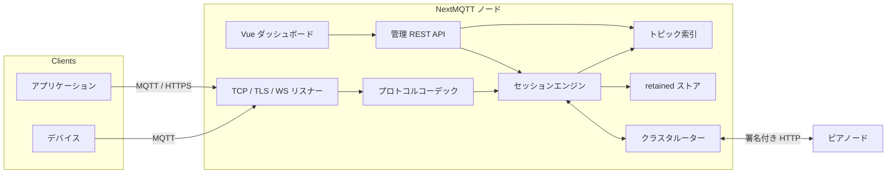

# NextMQTT

**.NET 10 と Vue 3 でネイティブに構築された次世代 MQTT プラットフォーム。**

[简体中文](README.md) | [English](README.en.md) | 日本語 | [한국어](README.ko.md)

NextMQTT は OASIS MQTT 3.1.1 と MQTT 5.0 仕様の独立した実装です。非同期ブローカー、
管理 REST API、リアルタイム運用ダッシュボード、Docker / Kubernetes のデプロイ資産を
提供します。

[](https://github.com/cn-cam/next-mqtt/actions/workflows/ci.yml)
[](LICENSE)
[](https://dotnet.microsoft.com/)
[](https://mqtt.org/)

---

## NextMQTT を選ぶ理由

- **新しい .NET 10 の基盤。** ブローカー、管理 API、ダッシュボードが 1 つの
  ASP.NET Core プロセスで動作します。外部データベースやメッセージミドルウェアは
  不要です。
- **運用のために設計。** クライアント/購読のライブ表示、retained の検査、クラスタ
  トポロジー、publish コンソール、API コンソール、Prometheus メトリクスを内蔵。
- **予測可能な並行性。** `System.IO.Pipelines` によるフレーミング、有界チャネルに
  よるバックプレッシャー、セッションごとの inflight ウィンドウ、全経路の非同期化。
- **最初からクラスタ対応。** コーディネータ不要の gossip メンバーシップと署名付き
  内部通信。ノードを追加するだけです。
- **単純なデプロイ。** マルチアーキテクチャイメージ、Helm チャート、Kubernetes
  マニフェスト、ヘルスプローブ、正常終了。

## 機能ハイライト

| 領域 | 機能 |
| --- | --- |
| プロトコル | MQTT 3.1.1 / 5.0（TCP、TLS、WebSocket、セキュア WebSocket） |
| QoS | 双方向 QoS 0/1/2、再送、inflight ウィンドウ |
| セッション | Clean start、永続セッション、期限、乗っ取り、オフラインキュー、ノード間引き継ぎとレプリカ |
| メッセージ | retained、メッセージ期限、遺言、遺言遅延 |
| 購読 | ワイルドカード、共有購読、no-local、retain-as-published、retain handling |
| セキュリティ | パスワード認証、JWT、匿名切替、トピック ACL、TLS、管理トークン |
| クラスタ | Gossip メンバーシップ、署名付きノード通信、ノード間ルーティング、グローバル共有購読 |
| 可観測性 | Prometheus メトリクス、JSON 統計、構造化ログ、ヘルスプローブ |
| 管理 | REST API、Vue 3 ダッシュボード、API コンソール、監査向け管理トークン |

## アーキテクチャ概要



ブローカーは**データプレーン**（接続、セッション、ルーティング、配信）と
**コントロールプレーン**（REST API、ダッシュボード、クラスタメンバーシップ）を
分離します。設計、データ構造、障害モデルは
[docs/ja/architecture.md](docs/ja/architecture.md) を参照してください。

## クイックスタート

### Docker

```bash
docker run -d --name nextmqtt \
  -p 1883:1883 \
  -p 8080:8080 \
  -e NEXTMQTT_ADMIN_PASSWORD='change-me-now' \
  ghcr.io/cn-cam/next-mqtt:latest
```

Docker Hub ミラー：

```bash
docker run -d --name nextmqtt \
  -p 1883:1883 -p 8080:8080 -p 8083:8083 \
  -e NEXTMQTT_ADMIN_PASSWORD='change-me-now' \
  oooooooooocam/next-mqtt:latest
```

<http://localhost:8080> を開き、`admin` と設定したパスワードでサインインします。
MQTT クライアントは `mqtt://localhost:1883` に接続します。

### 単体ノードと 3 ノード構成

どちらも同じイメージを使います：

```bash
# 単体ノード
cp .env.example .env
# 管理パスワードとトークンシークレットを編集
docker compose up -d

# 3 ノードクラスタ
export NEXTMQTT_CLUSTER_SECRET='a-long-shared-secret'
docker compose -f deploy/compose/docker-compose.cluster.yml up -d
```

3 ノードクラスタのホストポート：

| ノード | MQTT | ダッシュボード | HTTPS |
| --- | --- | --- | --- |
| node-a | 1883 | 8080 | 8086 |
| node-b | 1884 | 8081 | 8087 |
| node-c | 1885 | 8082 | 8088 |

HTTPS は証明書のホスト名とホストポートで開きます。例：
`https://next-mqtt.deploy-ssl.co:8086/`。Compose ではドキュメント内のコンテナ
ポート 8084 ではなく、このホストポートを使ってください。GitHub Pages はドキュメント
のみを配信し、ブローカーは実行しません。ブローカーは Docker、Compose、Kubernetes、
Helm でデプロイしてください。

### ソースから実行

```bash
# ブローカー + API（既定はローカル開発向け）
dotnet run --project src/NextMqtt.Server

# ダッシュボード開発サーバー（/api を :8080 へプロキシ）
cd web
npm install
npm run dev
```

要件：.NET SDK 10.0.100+、Node.js 22+（24 推奨）。

### コマンドラインクライアント

```bash
# 1 つのターミナルで購読
dotnet run --project src/NextMqtt.Cli -- sub --topic demo/# --qos 1

# 別のターミナルで公開
dotnet run --project src/NextMqtt.Cli -- pub --topic demo/hello --message hi --qos 1 --retain

# スループット確認
dotnet run --project src/NextMqtt.Cli -- bench --clients 20 --messages 1000 --size 128
```

CLI は MQTT 5 / 3.1.1、TLS に対応し、`hash-password` でダッシュボード/ACL の
パスワードハッシュを生成できます。

## ポート

| ポート | プロトコル | 用途 |
| --- | --- | --- |
| 1883 | MQTT over TCP | デバイスとアプリのトラフィック |
| 8883 | MQTT over TLS | 暗号化 MQTT |
| 8083 | MQTT over WebSocket（`/mqtt`） | ブラウザーとエッジ |
| 8084 | MQTT over セキュア WebSocket（`/mqtt`） | 暗号化ブラウザー |
| 8080 | HTTP | REST API、ダッシュボード、`/metrics`、`/healthz` |

すべてのポートは `NEXTMQTT_*` 環境変数または `appsettings.json` で変更できます。
[docs/ja/configuration.md](docs/ja/configuration.md) を参照してください。

## デプロイ

- コンテナイメージ：`ghcr.io/cn-cam/next-mqtt` と `oooooooooocam/next-mqtt`
  （linux/amd64、linux/arm64）
- Kubernetes：`deploy/kubernetes`（Kustomize）と `deploy/helm/next-mqtt`
- Compose：`docker-compose.yml` と
  `deploy/compose/docker-compose.cluster.yml`

```bash
kubectl apply -k deploy/kubernetes
# または
helm install nextmqtt deploy/helm/next-mqtt \
  --namespace nextmqtt --create-namespace \
  --set admin.password='change-me-now' \
  --set cluster.secret='change-me-shared-secret'
```

## リポジトリ構成

```text
src/NextMqtt.Core        MQTT コーデック、トピック一致、共有基盤
src/NextMqtt.Broker      セッション、ルーティング、retained、認証、クラスタ
src/NextMqtt.Server      ホスト、リスナー、REST API、静的ダッシュボード
src/NextMqtt.Cli         パブリッシュ/サブスクライブ/ベンチマーク CLI
tests/                   単体・統合テスト
web/                     Vue 3 + TypeScript ダッシュボード
docs/                    ドキュメントサイト（VitePress）と ADR
deploy/                  Docker、Compose、Kubernetes、Helm
```

## ドキュメント

ドキュメントサイトは**日本語、English、简体中文、한국어**で提供されます：
<https://cn-cam.github.io/next-mqtt/>。

- [アーキテクチャ](docs/ja/architecture.md) — コンポーネント、データ構造、拡張性
- [機能一覧](docs/ja/features.md) — 実装済み・一部・計画中
- [プロトコル](docs/ja/protocol.md) — 実装済み MQTT 機能と制限
- [設定](docs/ja/configuration.md) — すべてのオプションと環境変数
- [CLI](docs/ja/cli.md) — 公開、購読、ベンチマーク、パスワードハッシュ
- [セキュリティ](docs/ja/security.md) — 認証、ACL、TLS、管理 API
- [デプロイ](docs/ja/deployment.md) — 単体、クラスタ、Kubernetes
- [クラスタ](docs/ja/clustering.md) — メンバー、ルーティング、保証
- [開発](docs/ja/development.md) — ビルド、テスト、規約
- [API](docs/ja/api.md) — REST エンドポイント
- [ロードマップ](docs/ja/roadmap.md) — 今後の予定

## 独立性とコンプライアンス

NextMQTT は独立したクリーンルームプロジェクトです。他の MQTT ブローカー製品の
ソースコード、設定形式、ドキュメント文、ロゴ、商標を含まず、ベンダーとの提携も
主張しません。ブランド規則は CI で機械的に強制されます。
[AGENTS.md](AGENTS.md)、[TRADEMARKS.md](TRADEMARKS.md)、[NOTICE](NOTICE) を参照して
ください。

## コントリビュート

Issue と Pull Request を歓迎します。[CONTRIBUTING.md](CONTRIBUTING.md) を読み、
プッシュ前に `./scripts/compliance-check.sh` を実行してください。参加により
[Code of Conduct](CODE_OF_CONDUCT.md) に同意したものとみなされます。

## ライセンス

Apache-2.0。[LICENSE](LICENSE) を参照してください。
