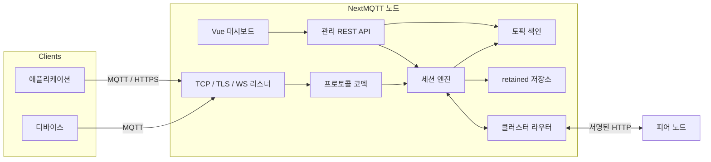

# NextMQTT

**.NET 10과 Vue 3로 네이티브하게 구축된 차세대 MQTT 플랫폼.**

[简体中文](README.md) | [English](README.en.md) | [日本語](README.ja.md) | 한국어

NextMQTT는 OASIS MQTT 3.1.1과 MQTT 5.0 명세의 독립 구현입니다. 비동기 브로커,
관리 REST API, 실시간 운영 대시보드, Docker / Kubernetes 배포 자산을 제공합니다.

[](https://github.com/cn-cam/next-mqtt/actions/workflows/ci.yml)
[](LICENSE)
[](https://dotnet.microsoft.com/)
[](https://mqtt.org/)

---

## NextMQTT를 선택하는 이유

- **새로운 .NET 10 기반.** 브로커, 관리 API, 대시보드가 하나의 ASP.NET Core
  프로세스에서 실행됩니다. 외부 데이터베이스나 메시지 미들웨어가 필요 없습니다.
- **운영을 위해 설계.** 클라이언트/구독 실시간 보기, retained 검사, 클러스터
  토폴로지, publish 콘솔, API 콘솔, Prometheus 지표를 내장.
- **예측 가능한 동시성.** `System.IO.Pipelines` 프레이밍, 유계 채널 백프레셔,
  세션별 inflight 윈도, 전 구간 비동기.
- **처음부터 클러스터 지원.** 코디네이터 없는 gossip 멤버십과 서명된 내부 통신.
  노드를 추가하기만 하면 됩니다.
- **단순한 배포.** 멀티 아키텍처 이미지, Helm 차트, Kubernetes 매니페스트, 상태
  프로브, 정상 종료.

## 기능 하이라이트

| 영역 | 기능 |
| --- | --- |
| 프로토콜 | MQTT 3.1.1 / 5.0(TCP, TLS, WebSocket, 보안 WebSocket) |
| QoS | 양방향 QoS 0/1/2, 재전송, inflight 윈도 |
| 세션 | Clean start, 영속 세션, 만료, 인계, 오프라인 큐, 노드 간 인계와 복제본 |
| 메시지 | retained, 메시지 만료, 유언, 유언 지연 |
| 구독 | 와일드카드, 공유 구독, no-local, retain-as-published, retain handling |
| 보안 | 비밀번호 인증, JWT, 익명 토글, 토픽 ACL, TLS, 관리 토큰 |
| 클러스터 | Gossip 멤버십, 서명된 노드 통신, 노드 간 라우팅, 전역 공유 구독 |
| 관측성 | Prometheus 지표, JSON 통계, 구조화 로그, 상태 프로브 |
| 관리 | REST API, Vue 3 대시보드, API 콘솔, 감사 친화적 관리 토큰 |

## 아키텍처 개요



브로커는 **데이터 플레인**(연결, 세션, 라우팅, 전달)과 **컨트롤 플레인**(REST API,
대시보드, 클러스터 멤버십)을 분리합니다. 설계, 데이터 구조, 장애 모델은
[docs/ko/architecture.md](docs/ko/architecture.md)를 참고하십시오.

## 빠른 시작

### Docker

```bash
docker run -d --name nextmqtt \
  -p 1883:1883 \
  -p 8080:8080 \
  -e NEXTMQTT_ADMIN_PASSWORD='change-me-now' \
  ghcr.io/cn-cam/next-mqtt:latest
```

Docker Hub 미러:

```bash
docker run -d --name nextmqtt \
  -p 1883:1883 -p 8080:8080 -p 8083:8083 \
  -e NEXTMQTT_ADMIN_PASSWORD='change-me-now' \
  oooooooooocam/next-mqtt:latest
```

<http://localhost:8080>을 열고 `admin`과 설정한 비밀번호로 로그인합니다. MQTT
클라이언트는 `mqtt://localhost:1883`에 연결합니다.

### 단일 노드와 3노드 배포

두 형태 모두 같은 이미지를 사용합니다:

```bash
# 단일 노드
cp .env.example .env
# 관리자 비밀번호와 토큰 시크릿 편집
docker compose up -d

# 3노드 클러스터
export NEXTMQTT_CLUSTER_SECRET='a-long-shared-secret'
docker compose -f deploy/compose/docker-compose.cluster.yml up -d
```

3노드 클러스터의 호스트 포트:

| 노드 | MQTT | 대시보드 | HTTPS |
| --- | --- | --- | --- |
| node-a | 1883 | 8080 | 8086 |
| node-b | 1884 | 8081 | 8087 |
| node-c | 1885 | 8082 | 8088 |

HTTPS는 인증서의 호스트 이름과 호스트 포트로 엽니다. 예:
`https://next-mqtt.deploy-ssl.co:8086/`. Compose에서는 문서의 컨테이너 포트
8084가 아니라 이 호스트 포트를 사용하십시오. GitHub Pages는 문서만 호스팅하며
브로커를 실행하지 않습니다. 브로커는 Docker, Compose, Kubernetes, Helm으로
배포하십시오.

### 소스에서 실행

```bash
# 브로커 + API(기본값은 로컬 개발용)
dotnet run --project src/NextMqtt.Server

# 대시보드 개발 서버(/api를 :8080으로 프록시)
cd web
npm install
npm run dev
```

요건: .NET SDK 10.0.100+, Node.js 22+(24 권장).

### 명령줄 클라이언트

```bash
# 한 터미널에서 구독
dotnet run --project src/NextMqtt.Cli -- sub --topic demo/# --qos 1

# 다른 터미널에서 발행
dotnet run --project src/NextMqtt.Cli -- pub --topic demo/hello --message hi --qos 1 --retain

# 처리량 확인
dotnet run --project src/NextMqtt.Cli -- bench --clients 20 --messages 1000 --size 128
```

CLI는 MQTT 5 / 3.1.1, TLS를 지원하며 `hash-password`로 대시보드/ACL 비밀번호
해시를 만들 수 있습니다.

## 포트

| 포트 | 프로토콜 | 용도 |
| --- | --- | --- |
| 1883 | MQTT over TCP | 디바이스와 애플리케이션 트래픽 |
| 8883 | MQTT over TLS | 암호화 MQTT 트래픽 |
| 8083 | MQTT over WebSocket(`/mqtt`) | 브라우저와 엣지 클라이언트 |
| 8084 | MQTT over 보안 WebSocket(`/mqtt`) | 암호화 브라우저 트래픽 |
| 8080 | HTTP | REST API, 대시보드, `/metrics`, `/healthz` |

모든 포트는 `NEXTMQTT_*` 환경 변수 또는 `appsettings.json`으로 설정합니다.
[docs/ko/configuration.md](docs/ko/configuration.md)를 참고하십시오.

## 배포

- 컨테이너 이미지: `ghcr.io/cn-cam/next-mqtt`와 `oooooooooocam/next-mqtt`
  (linux/amd64, linux/arm64)
- Kubernetes: `deploy/kubernetes`(Kustomize)와 `deploy/helm/next-mqtt`
- Compose: `docker-compose.yml`과
  `deploy/compose/docker-compose.cluster.yml`

```bash
kubectl apply -k deploy/kubernetes
# 또는
helm install nextmqtt deploy/helm/next-mqtt \
  --namespace nextmqtt --create-namespace \
  --set admin.password='change-me-now' \
  --set cluster.secret='change-me-shared-secret'
```

## 저장소 구조

```text
src/NextMqtt.Core        MQTT 코덱, 토픽 일치, 공유 기반
src/NextMqtt.Broker      세션, 라우팅, retained, 인증, 클러스터
src/NextMqtt.Server      호스트, 리스너, REST API, 정적 대시보드
src/NextMqtt.Cli         발행/구독/벤치마크 CLI
tests/                   단위 및 통합 테스트
web/                     Vue 3 + TypeScript 대시보드
docs/                    문서 사이트(VitePress)와 ADR
deploy/                  Docker, Compose, Kubernetes, Helm
```

## 문서

문서 사이트는 **한국어, English, 简体中文, 日本語**로 제공됩니다:
<https://cn-cam.github.io/next-mqtt/>.

- [아키텍처](docs/ko/architecture.md) — 컴포넌트, 데이터 구조, 확장성
- [기능 목록](docs/ko/features.md) — 구현됨, 일부, 계획
- [프로토콜](docs/ko/protocol.md) — 구현된 MQTT 기능과 제한
- [설정](docs/ko/configuration.md) — 모든 옵션과 환경 변수
- [CLI](docs/ko/cli.md) — 발행, 구독, 벤치마크, 비밀번호 해시
- [보안](docs/ko/security.md) — 인증, ACL, TLS, 관리 API
- [배포](docs/ko/deployment.md) — 단일 노드, 클러스터, Kubernetes
- [클러스터](docs/ko/clustering.md) — 멤버십, 라우팅, 보장
- [개발](docs/ko/development.md) — 빌드, 테스트, 규칙
- [API](docs/ko/api.md) — REST 엔드포인트
- [로드맵](docs/ko/roadmap.md) — 향후 계획

## 독립성과 컴플라이언스

NextMQTT는 독립적인 클린룸 프로젝트입니다. 다른 MQTT 브로커 제품의 소스 코드, 설정
형식, 문서 문구, 로고, 상표를 포함하지 않으며 벤더와의 제휴를 주장하지 않습니다.
브랜드 규칙은 CI에서 기계적으로 강제됩니다. [AGENTS.md](AGENTS.md),
[TRADEMARKS.md](TRADEMARKS.md), [NOTICE](NOTICE)를 참고하십시오.

## 기여

이슈와 Pull Request를 환영합니다. [CONTRIBUTING.md](CONTRIBUTING.md)를 읽고 푸시
전에 `./scripts/compliance-check.sh`를 실행하십시오. 참여는
[Code of Conduct](CODE_OF_CONDUCT.md)에 동의하는 것으로 간주됩니다.

## 라이선스

Apache-2.0. [LICENSE](LICENSE)를 참고하십시오.
