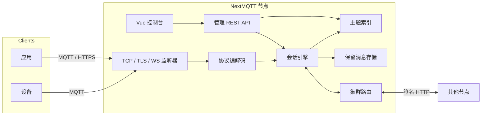

# NextMQTT

**下一代 MQTT 平台，原生构建于 .NET 10 与 Vue 3。**

简体中文 | [English](README.en.md) | [日本語](README.ja.md) | [한국어](README.ko.md)

NextMQTT 是 OASIS MQTT 3.1.1 与 MQTT 5.0 规范的独立实现，提供异步 Broker、管理
REST API、实时运维控制台，以及完整的 Docker / Kubernetes 部署资产。

[](https://github.com/cn-cam/next-mqtt/actions/workflows/ci.yml)
[](LICENSE)
[](https://dotnet.microsoft.com/)
[](https://mqtt.org/)

---

## 为什么选择 NextMQTT

- **全新的 .NET 10 基础。** Broker、管理 API 与控制台运行在同一个现代 ASP.NET Core
  进程中，不需要外部数据库或消息中间件。
- **为运维而生。** 内置客户端/订阅视图、保留消息检查、集群拓扑、发布控制台与
  Prometheus 指标。
- **可预测的并发。** `System.IO.Pipelines` 组帧、有界 Channel 背压、每会话 inflight
  窗口，全链路异步。
- **原生支持集群。** 无协调者的 gossip 成员管理与签名内部传输，随时增加节点。
- **简单的部署。** 多架构镜像、Helm Chart、Kubernetes 清单、健康探针与优雅停机。

## 功能概览

| 领域 | 能力 |
| --- | --- |
| 协议 | MQTT 3.1.1 与 5.0，支持 TCP、TLS、WebSocket、安全 WebSocket |
| QoS | 双向 QoS 0/1/2、重传与 inflight 窗口 |
| 会话 | Clean start、持久会话、会话过期、接管、离线队列、跨节点接管与副本 |
| 消息 | 保留消息、消息过期、遗嘱与遗嘱延迟 |
| 订阅 | 通配符、共享订阅、no-local、retain-as-published、retain handling |
| 安全 | 密码认证、JWT、匿名开关、主题 ACL、TLS、管理令牌 |
| 集群 | Gossip 成员、签名节点通信、跨节点路由、全局共享订阅 |
| 可观测性 | Prometheus 指标、JSON 统计、结构化日志、健康探针 |
| 管理 | REST API、Vue 3 控制台、API 控制台、审计友好的管理令牌 |

## 架构速览



Broker 将**数据面**（连接、会话、路由、投递）与**控制面**（REST API、控制台、集群
成员）分离。完整设计、数据结构与故障模型见
[docs/zh/architecture.md](docs/zh/architecture.md)。

## 快速开始

### Docker

```bash
docker run -d --name nextmqtt \
  -p 1883:1883 \
  -p 8080:8080 \
  -e NEXTMQTT_ADMIN_PASSWORD='change-me-now' \
  ghcr.io/cn-cam/next-mqtt:latest
```

Docker Hub 镜像：

```bash
docker run -d --name nextmqtt \
  -p 1883:1883 -p 8080:8080 -p 8083:8083 \
  -e NEXTMQTT_ADMIN_PASSWORD='change-me-now' \
  oooooooooocam/next-mqtt:latest
```

打开 <http://localhost:8080>，用 `admin` 和你设置的密码登录。MQTT 客户端连接
`mqtt://localhost:1883`。

### 单节点与三节点部署

仓库同时支持单节点和三节点两种形态，二者使用同一个镜像：

```bash
# 单节点
cp .env.example .env
# 编辑 .env 中的管理密码与令牌密钥
docker compose up -d

# 三节点集群
export NEXTMQTT_CLUSTER_SECRET='a-long-shared-secret'
docker compose -f deploy/compose/docker-compose.cluster.yml up -d
```

三节点集群的宿主机端口：

| 节点 | MQTT | 控制台 | HTTPS |
| --- | --- | --- | --- |
| node-a | 1883 | 8080 | 8086 |
| node-b | 1884 | 8081 | 8087 |
| node-c | 1885 | 8082 | 8088 |

HTTPS 使用证书中的域名访问，例如 `https://next-mqtt.deploy-ssl.co:8086/`；
不要在 Compose 部署中使用文档里的容器内部端口 8084。GitHub Pages 只托管文档，
不运行 Broker；部署 Broker 请使用 Docker、Compose、Kubernetes 或 Helm。

### 从源码运行

```bash
# Broker + API（默认配置适合本地开发）
dotnet run --project src/NextMqtt.Server

# 控制台开发服务器（把 /api 代理到 :8080）
cd web
npm install
npm run dev
```

要求：.NET SDK 10.0.100+，Node.js 22+（推荐 24）。

### 命令行客户端

```bash
# 一个终端订阅
dotnet run --project src/NextMqtt.Cli -- sub --topic demo/# --qos 1

# 另一个终端发布
dotnet run --project src/NextMqtt.Cli -- pub --topic demo/hello --message hi --qos 1 --retain

# 吞吐测试
dotnet run --project src/NextMqtt.Cli -- bench --clients 20 --messages 1000 --size 128
```

CLI 支持 MQTT 5 与 3.1.1、TLS，并可用 `hash-password` 生成控制台/ACL 密码哈希。

## 端口

| 端口 | 协议 | 用途 |
| --- | --- | --- |
| 1883 | MQTT over TCP | 设备与应用流量 |
| 8883 | MQTT over TLS | 加密 MQTT 流量 |
| 8083 | MQTT over WebSocket（`/mqtt`） | 浏览器与边缘客户端 |
| 8084 | MQTT over 安全 WebSocket（`/mqtt`） | 加密浏览器流量 |
| 8080 | HTTP | REST API、控制台、`/metrics`、`/healthz` |

所有端口都可通过 `NEXTMQTT_*` 环境变量或 `appsettings.json` 配置，见
[docs/zh/configuration.md](docs/zh/configuration.md)。

## 部署

- 容器镜像：`ghcr.io/cn-cam/next-mqtt` 与 `oooooooooocam/next-mqtt`
  （linux/amd64、linux/arm64）
- Kubernetes：`deploy/kubernetes`（Kustomize）与 `deploy/helm/next-mqtt`
- Compose：`docker-compose.yml` 与 `deploy/compose/docker-compose.cluster.yml`

```bash
kubectl apply -k deploy/kubernetes
# 或
helm install nextmqtt deploy/helm/next-mqtt \
  --namespace nextmqtt --create-namespace \
  --set admin.password='change-me-now' \
  --set cluster.secret='change-me-shared-secret'
```

## 项目结构

```text
src/NextMqtt.Core        MQTT 编解码、主题匹配、共享基础
src/NextMqtt.Broker      会话、路由、保留消息、认证、集群
src/NextMqtt.Server      宿主、监听器、REST API、静态控制台
src/NextMqtt.Cli         发布/订阅/压测命令行工具
tests/                   单元与集成测试
web/                     Vue 3 + TypeScript 控制台
docs/                    文档站点（VitePress）与 ADR
deploy/                  Docker、Compose、Kubernetes、Helm 资产
```

## 文档

文档站点提供**中文、English、日本語、한국어**四种语言：
<https://cn-cam.github.io/next-mqtt/>。

- [架构](docs/zh/architecture.md) — 组件、数据结构、扩展性
- [功能清单](docs/zh/features.md) — 已实现、部分实现与计划中的能力
- [协议支持](docs/zh/protocol.md) — 已实现的 MQTT 特性与限制
- [配置](docs/zh/configuration.md) — 所有选项与环境变量
- [命令行](docs/zh/cli.md) — 发布、订阅、压测、密码哈希
- [安全](docs/zh/security.md) — 认证、ACL、TLS、管理 API
- [部署](docs/zh/deployment.md) — 单节点、集群、Kubernetes
- [集群](docs/zh/clustering.md) — 成员、路由、保证与限制
- [开发](docs/zh/development.md) — 构建、测试、约定
- [API](docs/zh/api.md) — REST 端点
- [路线图](docs/zh/roadmap.md) — 后续计划

## 独立性与合规

NextMQTT 是独立的清室项目，不包含任何其他 MQTT Broker 产品的源代码、配置格式、
文档文字、Logo 或商标，也不声称与任何 Broker 厂商存在关联。品牌规则由 CI 机械
执行，见 [AGENTS.md](AGENTS.md)、[TRADEMARKS.md](TRADEMARKS.md) 与 [NOTICE](NOTICE)。

## 参与贡献

欢迎提交 Issue 与 Pull Request。请先阅读 [CONTRIBUTING.md](CONTRIBUTING.md)，并在
推送前运行 `./scripts/compliance-check.sh`。参与即表示同意
[Code of Conduct](CODE_OF_CONDUCT.md)。

## 许可证

Apache-2.0，见 [LICENSE](LICENSE)。
