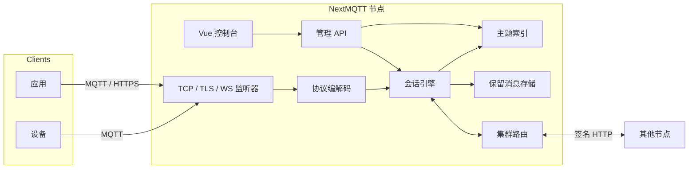

# NextMQTT

**基于 .NET 10 与 Vue 3 原生构建的下一代 MQTT 平台。**

NextMQTT 是 OASIS MQTT 3.1.1 / MQTT 5.0 规范的独立实现，包含异步 Broker、
管理 REST API、实时运维控制台，以及完整的 Docker / Kubernetes 部署资产。

[](https://github.com/cn-cam/next-mqtt/actions/workflows/ci.yml)
[](LICENSE)

## 特性

- **全新的 .NET 10 基础**：broker、管理 API 与控制台运行在同一个现代 ASP.NET
  Core 进程中，无需外部数据库或消息中间件。
- **面向运维**： 客户端/订阅实时视图、保留消息管理、集群拓扑、消息发布台、
  Prometheus 指标全部内置。
- **可预测的并发模型**： `System.IO.Pipelines` 组帧、有界 Channel 背压、
  会话级 inflight 窗口、全异步 I/O。
- **原生集群**： gossip 成员管理 + 签名节点通信 + 跨节点路由，无中心协调者。
- **部署简单**： 多架构镜像、Helm Chart、原生 Kubernetes 清单、健康探针与优雅停机。

| 领域 | 能力 |
| --- | --- |
| 协议 | MQTT 3.1.1 / 5.0，TCP、TLS、WebSocket、WSS |
| QoS | 双向 QoS 0/1/2，重传与 inflight 窗口 |
| 会话 | Clean Start、持久会话、会话过期、会话接管、离线队列 |
| 消息 | 保留消息、消息过期、遗嘱消息、遗嘱延迟 |
| 订阅 | 通配符、共享订阅、no-local、retain-as-published、retain handling |
| 安全 | 密码认证、JWT、匿名开关、主题 ACL、TLS、管理令牌认证 |
| 集群 | 成员 gossip、签名节点通信、跨节点路由 |
| 可观测 | Prometheus、JSON 统计、结构化日志、健康检查 |

## 架构速览



详细设计见 [docs/zh/architecture.md](docs/zh/architecture.md)。

## 快速开始

### Docker

```bash
docker run -d --name nextmqtt \
  -p 1883:1883 \
  -p 8080:8080 \
  -e NEXTMQTT_ADMIN_PASSWORD='change-me-now' \
  ghcr.io/cn-cam/next-mqtt:latest
```

Docker Hub 镜像：

```bash
docker run -d --name nextmqtt \
  -p 1883:1883 -p 8080:8080 -p 8083:8083 \
  -e NEXTMQTT_ADMIN_PASSWORD='change-me-now' \
  oooooooooocam/next-mqtt:latest
```

浏览器打开 <http://localhost:8080>，使用 `admin` 与上面设置的密码登录。
MQTT 客户端连接 `mqtt://localhost:1883`。

### Docker Compose 三节点集群

```bash
docker compose -f deploy/compose/docker-compose.cluster.yml up -d
```

### 源码运行

```bash
dotnet run --project src/NextMqtt.Server

cd web
npm install
npm run dev
```

环境要求：.NET SDK 10.0.100+，Node.js 22+（推荐 24）。

### 命令行客户端

```bash
dotnet run --project src/NextMqtt.Cli -- sub --topic demo/# --qos 1
dotnet run --project src/NextMqtt.Cli -- pub --topic demo/hello --message hi --qos 1 --retain
dotnet run --project src/NextMqtt.Cli -- bench --clients 20 --messages 1000 --size 128
```

CLI 支持 MQTT 5 / 3.1.1、TLS，并可用 `hash-password` 生成控制台或 ACL 密码哈希。

## 端口

| 端口 | 协议 | 用途 |
| --- | --- | --- |
| 1883 | MQTT TCP | 设备与应用流量 |
| 8883 | MQTT TLS | 加密 MQTT |
| 8083 | MQTT WebSocket (`/mqtt`) | 浏览器与边缘客户端 |
| 8084 | MQTT WSS (`/mqtt`) | 加密 WebSocket |
| 8080 | HTTP | REST API、控制台、`/metrics`、`/healthz` |

## 部署

- 镜像：`ghcr.io/cn-cam/next-mqtt` 与 `oooooooooocam/next-mqtt`（linux/amd64、linux/arm64）
- Kubernetes：`deploy/kubernetes` 与 `deploy/helm/next-mqtt`
- Compose：[`docker-compose.yml`](docker-compose.yml)

```bash
kubectl apply -k deploy/kubernetes
helm install nextmqtt deploy/helm/next-mqtt \
  --namespace nextmqtt --create-namespace \
  --set admin.password='change-me-now' \
  --set cluster.secret='change-me-shared-secret'
```

## 文档

文档站提供 **English、简体中文、日本語、한국어** 四种语言：
<https://cn-cam.github.io/next-mqtt/>。

- [功能对齐清单](docs/zh/features.md) — 已实现、部分实现与规划能力
- [命令行参考](docs/zh/cli.md) — 发布、订阅、压测与密码哈希
- [架构设计](docs/zh/architecture.md) — 组件、数据结构与扩展
- [部署](docs/deployment.md) — 单机、集群、Kubernetes
- [配置](docs/configuration.md) — 全部选项与环境变量
- [认证与 ACL](docs/authentication.md) — 用户、JWT 与主题规则
- [API](docs/api.md) — REST 接口
- [运维](docs/operations.md) — 指标、健康检查与排错

## 独立性与合规

NextMQTT 是独立的净室实现。仓库中不包含任何第三方 MQTT Broker 产品的源代码、
配置格式、文档文本、Logo 或商标，也不声称与任何厂商存在关联。
品牌禁用规则由 CI 机械校验，详见 [AGENTS.md](AGENTS.md)、
[TRADEMARKS.md](TRADEMARKS.md) 与 [NOTICE](NOTICE)。

## 贡献

请阅读 [CONTRIBUTING.md](CONTRIBUTING.md)，并在推送前运行
`./scripts/compliance-check.sh`。参与即表示同意
[CODE_OF_CONDUCT.md](CODE_OF_CONDUCT.md)。

## 许可证

Apache-2.0，见 [LICENSE](LICENSE)。
